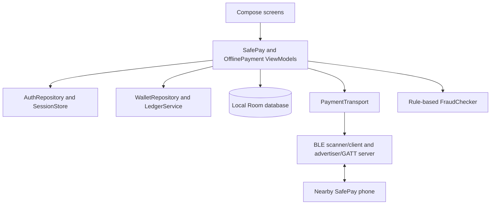

# SafePay — AI-Assisted Offline Bluetooth-Based Ledger Payment System

## 1. Abstract

SafePay is an Android college-project prototype for local virtual wallets and nearby BLE payment requests. It combines local registration, a Room ledger, Bluetooth Low Energy discovery/GATT messaging, user-confirmed peer verification, durable cross-device payment states, and explainable on-device fraud heuristics. It does not handle real money.

## 2. Problem statement

A disconnected payment demo has no shared server or database to coordinate two phones. The app must therefore preserve each phone's local record and show uncertainty honestly when communication stops. A BLE connection by itself is not proof of wallet identity and a successful GATT write is not proof that a receiver accepted or credited a payment.

## 3. Project objectives

- Keep registration, session, virtual balances, and history available offline.
- Demonstrate local same-database double-entry ledger transfers.
- Discover and communicate with a nearby SafePay BLE peer.
- Authenticate a peer's app key using an in-person comparison step.
- Persist sender and receiver payment state before dependent protocol messages.
- Avoid duplicate local credits and show pending/reconciliation states on uncertain outcomes.
- Explain rule-based risk results to the user.

## 4. Technology stack

- Kotlin, Android SDK, Jetpack Compose, Material 3, MVVM, coroutines, and StateFlow.
- Room 2.8.4 for local persistence and schema migration; DataStore for the active user ID.
- BLE GATT client/server and advertiser/scanner APIs.
- PBKDF2-HMAC-SHA256 password hashing; Android Keystore P-256 ECDSA signing keys.
- JUnit 4 for JVM tests and AndroidX JUnit/Room testing for instrumentation tests.
- Gradle Android Plugin 8.13.2, Kotlin 2.2.21, Java 17 bytecode, compile SDK 36, target SDK 35, min SDK 26.

## 5. System architecture

The database and Keystore are local to each installation. The sender and receiver do not share a database or clock authority. The old `CrossDeviceTransferPort` and `cross_device_requests` table are retained for Phase 2 compatibility/tests; the active BLE workflow uses `OfflinePaymentViewModel` and `offline_payments`.

## 6. Bluetooth communication workflow

Both phones use the same application. The receiver opens **Receive Money**, grants the permissions shown by Android, and starts advertising. The sender opens **Send Money**, scans for the SafePay service, selects an actual scan result, and connects as GATT central/client. Connection is only reported after GATT service discovery and subscription setup. BLE operations use queued writes/indications and bounded message fragments with reassembly and duplicate filtering.

Service UUID: `6a4f5a10-2a19-4e8f-9a04-3e6c1a0b7d21`  
Peer introduction: `6a4f5a11-2a19-4e8f-9a04-3e6c1a0b7d21`  
Payment/test message: `6a4f5a12-2a19-4e8f-9a04-3e6c1a0b7d21`  
Indicated response: `6a4f5a13-2a19-4e8f-9a04-3e6c1a0b7d21`

Android 12+ uses `BLUETOOTH_SCAN`, `BLUETOOTH_CONNECT`, and `BLUETOOTH_ADVERTISE`; Android 11 and earlier use legacy Bluetooth and location permission for scanning. BLE peripheral advertising is optional on Android devices, so some devices can scan/connect but cannot act as the advertiser. The app stops BLE work when it goes to the background; keep it open during the prototype.

### Payment message sequence

1. `PEER_HELLO`: wallet ID, display name, public key, nonce, and signature.
2. Users compare the displayed six-digit code in person and explicitly trust the peer key on each phone.
3. `PAYMENT_REQUEST`: sender persists the transaction and reserves funds before sending.
4. Receiver persists the request and chooses accept/reject. `PAYMENT_ACCEPT` or `PAYMENT_REJECT` is signed.
5. `PAYMENT_PREPARED`: sender and receiver persist their prepared states.
6. Sender persists a local debit and signed commit evidence, then sends `PAYMENT_COMMIT`.
7. Receiver credits locally once, persists completion, and sends signed `PAYMENT_ACK`.
8. `PAYMENT_STATUS_QUERY` and `PAYMENT_STATUS_RESPONSE` support reconnection and reconciliation.

Every payment envelope is versioned and includes a random message ID, random transaction ID, sender/receiver wallet IDs, author wallet ID, integer paise amount, protocol state, nonce, and ECDSA signature. The decoder checks message-specific states and rejects non-integer/out-of-range amounts. Private keys stay in Android Keystore. The short code is an out-of-band user comparison, not a substitute for secure key custody or bank-grade identity verification.

## 7. Wallet and ledger design

All amounts are signed 64-bit integer minor units (paise); the app does not use floating-point money. Each new wallet receives a one-time local demo opening credit of 500,000 paise (₹5,000), stored in `WalletEntity.initialBalanceMinor`. The opening amount is simulated value, not a real-money deposit.

Ledger entries store positive amounts. `DEBIT` reduces the wallet; `CREDIT` increases it. For a local transfer, `LedgerService` validates both wallets and overflow, then creates matching DEBIT/CREDIT entries and marks the transaction completed in one Room transaction. Posted balance is the opening credit plus credits minus debits. Pending sender transfers reduce available funds through reservations.

Primary Room records:

- `UserEntity`: UUID user ID, normalized unique username, PBKDF2 hash/salt, creation time.
- `WalletEntity`: wallet ID, user ID, opening demo credits, creation time; one wallet per user.
- `TransactionEntity`: local transfer parties, amount, status, and timestamps.
- `LedgerEntryEntity`: positive DEBIT/CREDIT amount tied to a transaction and wallet.
- `OfflinePaymentEntity`: one phone's durable view of a cross-device payment, risk details, protocol state, outbox, and commit evidence.
- `OfflinePaymentEntryEntity`: the sender's local DEBIT or receiver's local CREDIT, unique by transaction/wallet/type.
- `VerifiedPeerEntity`: peer public key and fingerprint accepted after the comparison step.
- `ProcessedPaymentMessageEntity`: durable message-ID replay protection.

Schema version 4 includes a 3→4 migration for payment state, entries, peer trust, and processed messages. Database opening from schema versions 1 or 2 uses the configured destructive fallback because those schemas predate the Phase 2 user/ledger model.

### Cross-device limitation

A separate Room transaction cannot atomically update two phones. Each completed cross-device transfer has a local sender debit record on A and a local receiver credit record on B, associated by the same transaction ID; neither phone holds both entries as a local pair. The receiver's signed receipt is that app's attestation of its local persisted credit. Reconciliation preserves uncertain states and does not automatically refund or create a new transaction. A software-only offline wallet cannot guarantee prevention of global double-spending or malicious modification on a device. This is a prototype, not banking software.

## 8. Fraud detection methodology

`FraudChecker` runs entirely on-device and is rule-based, not a trained machine-learning model. Configurable defaults add risk for amounts at or above ₹1,000 and ₹5,000, amounts at least two or three times local typical spend, three or more outgoing payments in one hour, repeated payments to one receiver in a day, and repeated attempts. Score is clamped to 0–100; MEDIUM starts at 40 and HIGH at 70. Medium risk requires an extra confirmation; high-risk transfers are blocked by the demo policy. Reasons are displayed with the score and level.

## 9. Application features and screen map

- **Welcome:** SafePay title and Get Started navigation.
- **Login/Register:** local account creation, username/password validation, duplicate-name rejection, PBKDF2 hashes, persisted session, and logout.
- **Wallet Dashboard:** logged-in user, locally calculated posted/available/reserved amounts, recent BLE payment state, and Bluetooth status.
- **Send Money:** real BLE scan results, connection controls, peer verification, amount validation, risk explanation, confirmation, transaction state, and reconciliation actions. Same-device LOCAL DEMO transfer is separately labeled and debug-build-only.
- **Receive Money:** advertising controls, verified sender, incoming request details, risk explanation, accept/reject, and transaction state.
- **Transaction History:** local ledger history plus local records for sent/received BLE payments, including ID, date, amount, state, and risk indicator.
- **Profile:** account/wallet information, local demo label, and logout.

## 10. Installation and build instructions

1. Install Android Studio with Android SDK Platform 36 and a compatible JDK (17 recommended).
2. Open the existing project folder and allow Gradle sync to download the versions declared in `gradle/libs.versions.toml`.
3. The repository does not currently include `gradlew`/`gradlew.bat`. If Gradle 8.13 is installed, create the wrapper from the project root with `gradle wrapper --gradle-version 8.13`.
4. Build and run the `app` debug configuration on an Android 8/API 26+ device or emulator.
5. Windows command examples after wrapper generation: `gradlew.bat :app:testDebugUnitTest`, `gradlew.bat :app:connectedDebugAndroidTest`, and `gradlew.bat :app:assembleDebug`.
6. A successful debug APK is normally written to `app/build/outputs/apk/debug/app-debug.apk`. That file does not exist until the build succeeds.
7. To install using Android Studio, select the phone and press Run. Alternatively, after SDK platform-tools are installed, use `adb install -r app/build/outputs/apk/debug/app-debug.apk`.

The current checked environment had no Gradle executable/wrapper, Android SDK, adb, or Kotlin compiler. Therefore no APK was generated and no build/test result is claimed.

## 11. Testing instructions and current results

Tests present in the project:

- `BleProtocolTest`: message framing/validation, chunk reassembly, duplicate chunks, and expiry.
- `OfflinePaymentProtocolTest`: signature verification/tampering, message-state/amount validation (including fractional and out-of-range JSON amounts), verification code binding, and fraud rules.
- `LedgerIntegrationTest`: registration, duplicate usernames, login, opening balance persistence, local balanced transfers, insufficient/invalid amounts, duplicate transaction IDs, overflow, logout, and legacy pending request persistence.
- `OfflinePaymentFlowTest`: two Room databases connected by a fake transport, ₹5,000→₹4,500 and ₹2,000→₹2,500 completed scenario, duplicate request and COMMIT handling, receiver rejection, missing-ACK reconciliation, pending-reservation persistence after database reopen, invalid amount, and insufficient funds.

These tests have been added but **not executed in the current environment**. The manifest XML parsed successfully. Compilation, test execution, and APK generation remain unverified until run on a configured Android build host.

## 12. Manual two-phone test checklist

Use two BLE-capable Android phones with the same debug APK and separate SafePay accounts. Keep both apps in the foreground. Wi-Fi/mobile data may be disabled; BLE itself does not use them.

1. Install and open the app on each phone; register/log in separately and verify the local demo opening balances.
2. Enable Bluetooth on both phones and grant only the requested Bluetooth permissions.
3. On Phone B, open **Receive Money** and tap **Start Receiving**. Confirm the advertising status.
4. On Phone A, open **Send Money**, tap **Scan Nearby Devices**, select Phone B's actual SafePay scan result, and connect.
5. Compare the six-digit code displayed on both phones in person. Enter and confirm the code on both devices.
6. On A, enter `500.00` and request the transfer. Review risk messaging. On B, inspect the sender/amount and accept.
7. Wait until both devices show the same transaction ID and completed local state. Check A's balance is ₹4,500 and B's is ₹2,500; inspect history and each phone's local ledger/payment record.
8. Close and reopen both apps and confirm the local state persists. Then repeat with receiver rejection, insufficient funds, Bluetooth disabled/disconnected before acceptance, and a disconnect during commit. Uncertain cases should remain pending/reconciliation-required.

**Physical-device status: NOT PHYSICALLY VERIFIED.** No two-phone test was performed in this environment. BLE behavior and advertiser support vary by device and Android vendor.

## 13. Known limitations and security notes

- No real currency, bank, UPI, internet, cloud, or payment gateway is used.
- Independent phones cannot atomically commit a shared ledger or fully prevent offline double-spending.
- A signed receipt is an app-level attestation; it does not protect against a malicious/rooted/modified phone.
- The BLE link does not provide application-level confidentiality; signatures authenticate protocol content but do not encrypt payment details.
- Peer key change is blocked rather than silently trusted; safely migrating identities/keys is not implemented.
- Receiver/advertiser mode needs hardware and Android support. Foreground operation is required for this prototype; no foreground service/background payment mode is implemented.
- Android backup is disabled because local Room data and device-bound Keystore keys should not be restored independently.
- Build, automated tests, physical BLE testing, and APK installation remain unverified until performed on suitable hardware/tooling.

## 14. Future improvements

- Execute and expand the JVM and instrumentation suites on CI with Android SDK/Gradle.
- Test the full payment and failure/reconnect matrix on multiple physical Android devices and vendors.
- Add a user-visible, auditable reconciliation screen and supported key recovery/change process.
- Consider hardware-backed key attestation and application-level encryption with reviewed standards if the threat model requires them.
- Add stronger ledger audit/export tools and test database migrations from each supported historical version.
- Evaluate fraud thresholds against a documented synthetic dataset; retain the rule-based label unless a real on-device ML model is implemented and evaluated.
